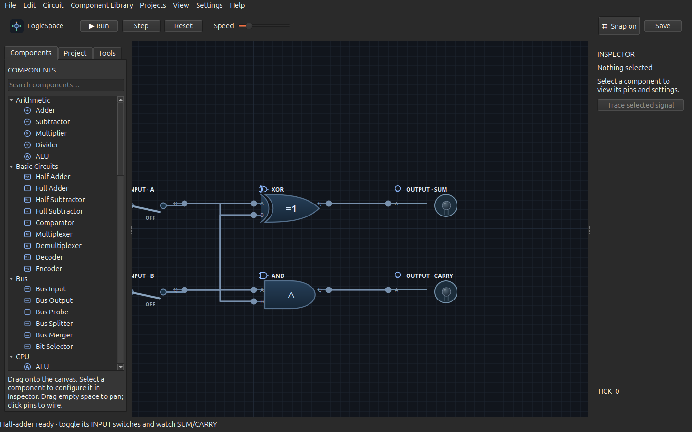
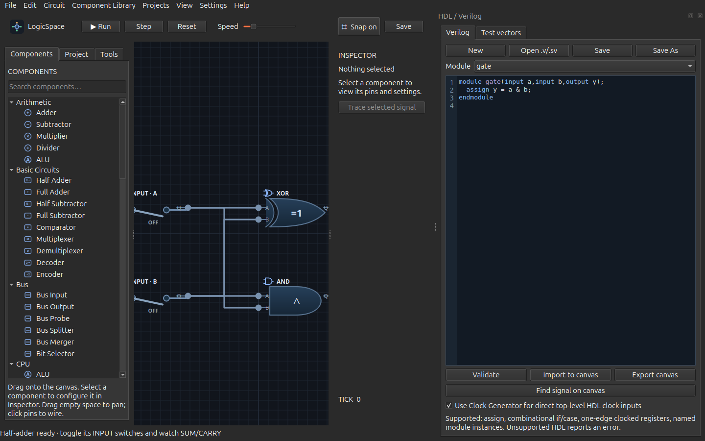

# LogicSpace

**Build digital circuits. See signals move. Understand the machine you built.**

LogicSpace is a Python and PySide6 desktop sandbox for digital circuits. Its canvas is backed by a digital logic simulator: wires connect actual pins, clocks advance state, and debugging tools inspect simulated values. Projects are human-readable JSON. The published 3.0.0 release targets Ubuntu/Linux; a Windows 10/11 x64 installer and portable package are being prepared for 3.1.0.

HDL editor screenshot

A GIF or video walkthrough is not available yet. The screenshots above were captured from the running Wayland application.

## At a glance

| Area | What you can do |
| --- | --- |
| Circuit canvas | Place and wire gates, switches, lights, buses, registers, clocks, arithmetic and memory components |
| Simulation | Run, pause, step, reset, inspect binary 0/1/X, and restore earlier states |
| CPU and Assembly | Build or bind a wired 8-bit ISA 2.1 CPU, assemble programs, load ROM and debug execution |
| HDL | Edit a documented Verilog/SystemVerilog subset, import it as editable components, export supported circuits, and run vector tests |
| Debugging | Timing Diagram, Logic Analyzer, Signal Tracing, Time Travel, breakpoints, RAM/ROM watchpoints and Memory Inspector |
| Projects | Templates, interactive lessons, custom blocks, global component library, local gallery and data-only ZIP sharing |
| FPGA preparation | Validate a user-supplied device profile and port constraints, then export a self-contained HDL + iCE40 PCF package |

## First five minutes

1. Launch LogicSpace and choose **Try the half-adder example** on the Start screen.
2. Toggle its two INPUT switches. Observe the SUM and CARRY outputs and wire colors.
3. Use **Step** for a clocked example. Open **View → Timing Diagram** to record selected pins.
4. Press **Ctrl+F** to find a component or signal. Press **F1** for the in-app guide.

The example opens as an editable copy. The bundled source file is not changed.

## Install on Ubuntu 24.04+

Download the current source ZIP from [GitHub Releases](https://github.com/Kuattt/LogicSpace-/releases) or clone this repository. Unpack it into a directory you own, then run:

~~~bash
cd LogicSpace-3.0.0  # use the extracted version directory, or your clone
./install.sh
./launch.sh
~~~

The installer places PySide6 Essentials in the project-local .deps directory when needed and creates a desktop entry under your user account. It does not require sudo. Python 3.12 or newer and a graphical Linux session are required. Minimal Linux installations may also need Ubuntu's `libegl1` package (`sudo apt install libegl1`). A prebuilt Debian or AppImage package is not provided.

## Windows 10/11 x64 release candidate

The [native Windows CI workflow](https://github.com/Kuattt/LogicSpace-/actions/workflows/windows-build.yml) builds one installer (`LogicSpace-Setup.exe`) and one portable archive (`LogicSpace-Windows-x64.zip`). Both contain the same PyInstaller application, Python 3.12 runtime and PySide6/Qt files; neither needs a separate Python installation. The 3.1.0 candidate must pass that workflow before release. Until then, use the [Releases page](https://github.com/Kuattt/LogicSpace-/releases) for public downloads; CI artifacts are not published release downloads.

The installer runs per user and provides a Start menu shortcut, an optional desktop shortcut and an uninstaller. For the portable version, extract the entire ZIP and run `LogicSpace/LogicSpace.exe`. User projects should be saved outside the application folder; settings, templates and the component library use `%LOCALAPPDATA%\LogicSpace`. The Windows CI checks silent install, launch, reinstall and uninstall, but an interactive Windows 10/11 review of the wizard and circuit workflows is still outstanding. The packages are unsigned, so Windows SmartScreen may display a warning. Do not disable Windows security features.

External Icarus, Yosys and Verilator execution is unavailable on Windows because the current restricted subprocess runner uses Linux Bubblewrap. Internal HDL editing, import/export and LogicSpace simulation remain available. GTKWave requires a separate compatible installation.

### Dependencies

| Dependency | Purpose |
| --- | --- |
| Python 3.12+ | Application and simulator |
| PySide6-Essentials 6.7–6.x | Native desktop GUI |
| libegl1 (Ubuntu package) | Qt graphics runtime on minimal installations |
| Python standard library | JSON projects, assembler, HTTP update checks, tests |

Optional: Icarus Verilog (iverilog and vvp), Yosys, Verilator, GTKWave and Bubblewrap. External HDL execution requires usable Bubblewrap namespaces; installing the executables alone may not be enough. LogicSpace runs without any of these optional tools.

For development, install the sole required Python package with:

~~~bash
python3 -m pip install -r requirements.txt
./launch.sh
~~~

Do not put personal projects inside a release archive before sharing it. User libraries, templates, tutorial progress, gallery records, benchmark history and update preferences are stored under ~/.local/share/logicspace. The source-based updater never replaces those files.

On Windows, the corresponding user data is under `%LOCALAPPDATA%\LogicSpace`. Removing the application does not intentionally remove that directory. Back up important projects before changing installations.

## Architecture overview

~~~mermaid
flowchart LR
    Editor["PySide6 canvas and panels"] --> Circuit["Circuit JSON model"]
    Circuit --> Simulator["engine.py Simulator"]
    Simulator --> Debug["Timing, tracing, Time Travel, testbench"]
    HDL["HDL parser / AST"] --> Circuit
    Assembly["Two-pass assembler"] --> ROM["Wired CPU ROM"]
    ROM --> Circuit
~~~

engine.py is the sole logical simulator. Sequential components preserve state; a simulation step samples settled combinational inputs and commits state updates. The time axis measures **logical steps**, not nanoseconds or physical propagation delay. GUI rendering and user data stores are separate from the simulation engine. Version-1 project JSON remains readable; newer metadata is optional.

## CPU and Assembly

The built-in 8-bit ISA 2.1 uses four registers, an 8-bit address space, ROM, RAM, ALU, Program Counter, Instruction Register and a wired Control Unit. It supports arithmetic, logic, loads/stores, branches, stack operations and calls. Assembly is converted to machine code and loaded into the selected CPU's actual ROM; execution uses connected LogicSpace components and the existing Simulator. See [Assembly examples](examples/assembly/README.md) and the [detailed guide](docs/detailed-guide.md) for the instruction table and CPU binding workflow.

## Verilog HDL

The HDL dock supports modules, ports, wires/logic, assign expressions, named module instances, limited combinational always blocks, clocked always/always_ff blocks, if/else, case, D Flip-Flops, registers, constant-index bit writes, and a strict single-address RAM/ROM array subset. Imported logic is made of editable components and BusWire connections. Active-high and active-low asynchronous reset are supported for the documented full-literal reset form. Unsupported HDL yields a diagnostic; this is **not** a complete Verilog or SystemVerilog implementation.

Use **View → HDL / Verilog…** to open a .v/.sv file, validate it, import it to the canvas or export a supported circuit. Imported signal names link to their generated components. See [HDL examples](examples/hdl30/README.md). Internal vector tests use LogicSpace's Simulator. Optional Icarus comparison is independent only when iverilog, vvp and the required sandbox actually run.

## Digital circuit simulator and debugging

BusWire carries 1, 2, 4, 8, 16 or 32 bits with bit 0 as LSB. Width mismatches are rejected. The Inspector exposes component configuration and live pins. Timing Diagram and Logic Analyzer show recorded logical-step waveforms. Signal Tracing distinguishes connectivity from simulation-backed explanations when causal data exists. Time Travel stores bounded state snapshots and supports branches and checkpoints.

The Memory Inspector displays and edits RAM/ROM contents with confirmed changes and Time Travel history. Advanced Debugger supports signal conditions and address-specific memory watchpoints. Testbenches run on isolated circuit copies, preserving the live editor state.

## FPGA workflow

The FPGA panel can validate top modules, assigned pins, clock constraints and user-supplied device profiles, then export an HDL + nextpnr iCE40 PCF ZIP. A known non-iCE40 profile is rejected for iCE40 PCF output. LogicSpace does not include a verified device pin database. Export does **not** synthesize, place, route, program a board or prove physical timing. Yosys and Verilator actions run only when those tools and the restricted subprocess environment are available.

## Updates

Choose **Settings → Check for Updates…** to query the official GitHub Releases API. Automatic checks are enabled by default, run no more than once per day and can be disabled in **Settings → Update Settings…**. Prereleases are opt-in. The request uses a short timeout and sends no project data.

This source distribution cannot be safely replaced in place, especially when edited locally. **Update Now opens the official release page for a manual download**; it does not install code, run scripts from GitHub, change projects or claim rollback. Release history is available from the same settings dialog.

## Tests and benchmarks

~~~bash
PYTHONPATH=.deps python3 -m unittest discover -s tests -q
python3 -m py_compile *.py tests/*.py
bash -n launch.sh
~~~

The Bench tab builds standard circuits, measures construction separately from simulation, counts completed steps and observed output changes, and exports CSV/JSON. Its local history compares runs only when the preset, topology counts, step count and reported software platform match. Wall-clock times depend on load and hardware; they are not circuit delays.

## Current limitations and roadmap

- HDL supports a checked subset; arbitrary slicing, multiple reset events and generalized multiport HDL memories are unsupported.
- The simulator does not model physical propagation, setup/hold timing or a full HDL delta-cycle queue.
- FPGA profiles are supplied by users; real synthesis and board behavior require external tools and verification.
- Automatic in-place installation and rollback are unavailable for source checkouts. A separately packaged, versioned Linux install would be needed.
- Windows packages have passed automated Windows CI but still need interactive testing on Windows 10 and 11; external HDL tools are unavailable there.
- A native Linux package, automated desktop interaction tests, a video walkthrough and a project format migration path are future work.

## FAQ

**Can I open an older project?** Existing JSON projects remain supported; five bundled older examples were loaded and stepped during release preparation. Keep a backup before editing valuable projects.

**Does LogicSpace simulate physical timing?** No. Timing Diagram steps are logical simulation steps, not calibrated hardware time.

**Does FPGA export build a bitstream?** No. It prepares checked HDL and constraint files; synthesis and board programming require external tools.

**How do updates work?** The app can check GitHub Releases and open the official release page. It does not silently install or replace files.

See [CHANGELOG](CHANGELOG.md), [release notes](RELEASE_NOTES.md), [Issues](https://github.com/Kuattt/LogicSpace-/issues) and [Releases](https://github.com/Kuattt/LogicSpace-/releases). Before contributing, read [CONTRIBUTING](CONTRIBUTING.md) and [SECURITY](SECURITY.md).

## License and third-party software

The published **v3.0.0** source archive contains no LogicSpace project license.
The proposed [LogicSpace Proprietary Source-Available License](LICENSE.md) is
currently a **draft for rights-holder and legal review**, not an approved term
of that earlier release. Its proposed terms allow personal use and private
local non-commercial modifications, while requiring separate written
permission for redistribution, derivative products and commercial use. It
does not grant rights to the LogicSpace name or branding. One approved version
of these terms is intended to cover original LogicSpace materials on Linux
and Windows for a future release; it will not be applied retroactively to
v3.0.0. LogicSpace is not represented as OSI Open Source.

The [commercial licensing notice](COMMERCIAL-LICENSE.md) is also a draft; it
is **not** a signed agreement and grants no commercial rights. Third-party
libraries and runtimes retain their own terms. See the
[third-party notices and open release checks](THIRD_PARTY_NOTICES.md) and the
[rights-review checklist](docs/licensing-review-3.1.0.md). Public GitHub
visibility also carries GitHub's own platform terms for viewing and forking.
Windows binary publication awaits review of the bundled PySide6/Qt, Python,
Microsoft and other third-party components.
